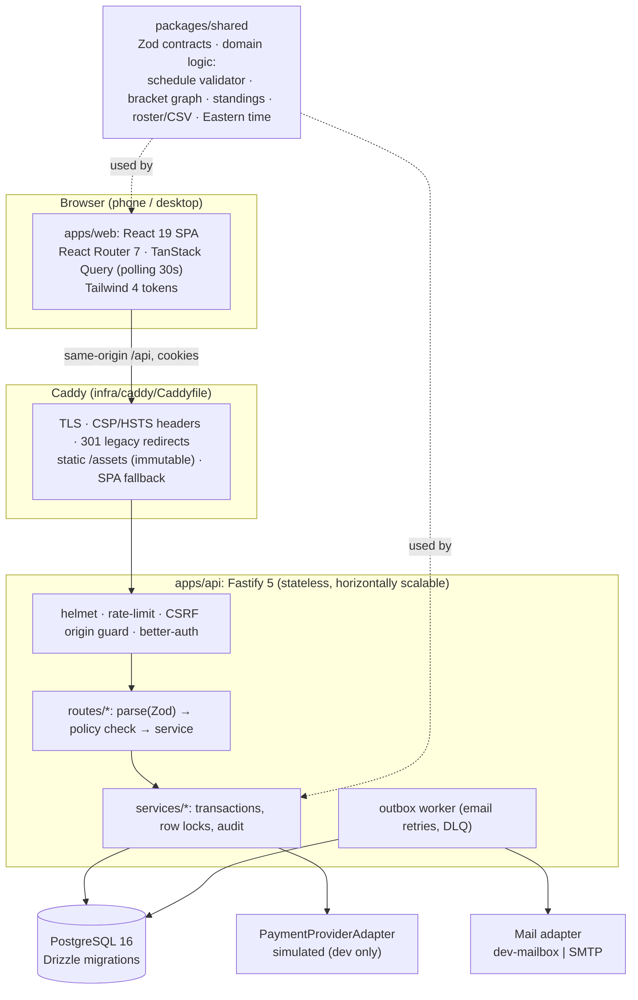

# Architecture



## Request lifecycle

1. Caddy terminates TLS, adds security headers, and proxies `/api/*` and `/sitemap.xml` to the API.
2. Fastify runs, in order: `helmet` → global rate limit → CSRF origin guard (unsafe methods) → route.
3. The route parses input with a shared Zod schema (`lib/validate.ts`, 400 with field errors).
4. The route checks authorization with `lib/context.ts` (session + roles) and `lib/policy.ts`. The default is deny.
5. The service runs in a transaction and takes row locks where there's contention:
   - registration: `divisions` row `FOR UPDATE` (lock order division → team / registration)
   - schedule publish: `tournaments` row + all its `games` rows `FOR UPDATE`
   - score entry: the `games` row, plus downstream bracket games when a winner changes
6. The service writes an audit event for staff/sensitive actions, in the same transaction.
7. The response is an explicit DTO. Public endpoints build *safe projections* (`services/public.ts`).

## Key design choices (see DECISIONS.md for full ADRs)

- **Draft vs published schedule** (ADR-007): `games` holds the draft; `games.published` (JSONB) holds
  the public projection. Publishing is atomic and versioned (`schedule_versions`, `game_versions`).
  Score/status changes on published games go live immediately and are also versioned.
- **Brackets are a persisted graph**: `bracket_matchups` + `bracket_slots` + `bracket_advancement_edges`
  with unique constraints (one outgoing edge per matchup, one feeder per slot) and integrity checks
  (`validateBracketGraph`). Bracket games are ordinary `games` rows linked by `bracket_matchup_id`,
  so the schedule is the single source of truth.
- **Advancement only on `final`**: a correction that changes a winner while later games have started
  returns `DOWNSTREAM_CONFLICT`. The director must choose `reset_downstream` (clear later results,
  re-advance) or `keep_downstream` (logged override). Nothing cascades silently.
- **Roster snapshots**: every save refreshes the snapshot for *unlocked* active registrations only.
  After the roster deadline (or "Lock rosters now"), the event roster is frozen. Staff can revise it
  with a reason.
- **Email outbox**: messages are rows first, sent second; retries use exponential backoff and end
  in a `dead` state after 6 attempts. Logs carry ids, never addresses.
- **Payments**: `payment_status` is independent of `registration.status`. Only a signature-verified,
  idempotent webhook can set `paid_verified`.

## Frontend structure

```
apps/web/src
  components/   ui kit (accessible fields, dialog, badges), Layout, GameCard, Bracket, Standings, alerts
  lib/          api client (typed errors), auth hooks, seo, format
  pages/public  home, finder, tournament tabs, game day, facilities, CMS pages, contact
  pages/auth    login (+TOTP), sign-up, verify, reset; RequireAuth (UX guard only)
  pages/dashboard  coach portal: teams, roster editor/import, registration flow, prefs, 2FA
  pages/admin   setup, divisions, registrations, schedule board, brackets, game ops, notices, org admin
```

Private areas are lazy-loaded. Initial public JS measured at about 135 KB gzipped (110 KB cacheable vendor chunk + 25 KB app).
Markdown rendering loads on demand.

## Scaling notes (not measured; see the load test in `infra/load`)

The API is stateless: sessions and rate-limit counters for auth live in Postgres, so you can run more
than one API instance behind Caddy or a load balancer. Fastify's global rate limiter is **in-memory per
instance**, so a shared store (Redis) is needed for exact global limits across instances. Public GETs are
cacheable for 15 s, which absorbs refresh bursts. Run the k6 script against staging and record the
results before choosing instance sizes.
