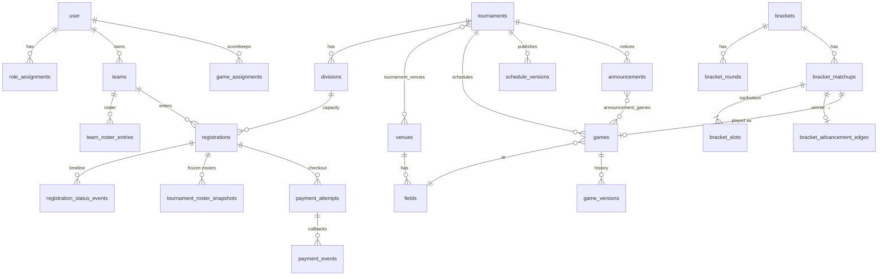

# Data Model

Source of truth: `apps/api/src/db/schema.ts` (domain) and `auth-schema.ts` (better-auth).
Migrations are in `apps/api/drizzle/`. Conventions: UUID keys, `timestamptz` (UTC),
`version` integer for optimistic concurrency, `is_demo` on seedable records.

## Tables (spec §14 mapping)

| Spec table | Implementation | Notes |
|---|---|---|
| users, sessions | `user`, `session`, `account`, `verification`, `two_factor`, `rate_limit` | better-auth managed. `two_factor` backs staff MFA. |
| roles, role_assignments | `staff_role` enum + `role_assignments(user, role, tournament_id?)` | `tournament_id` null = org-wide. Unique per (user, role, scope). |
| (scorekeeper scope) | `game_assignments(user, game)` | Scorekeepers can score only assigned games. |
| organizations | `organizations` | Single org today, kept for portability. |
| teams, team_memberships | `teams`, `team_memberships` | Coach contact fields are private (never projected publicly). |
| players, team_roster_entries | `team_roster_entries(player_name, jersey_number text)` | **No separate `players` table** (ADR-008, privacy). Check: jersey `^[0-9]{1,2}$`. |
| tournament_roster_snapshots | same | Unique (registration, revision). Append-only revisions. |
| tournaments, divisions | same | Check `ends_on >= starts_on`, `capacity > 0`. Tie-breakers stored as JSON per division. |
| venues, fields | `venues`, `fields`, `tournament_venues` | Unique field name per venue. |
| registrations | same | **Partial unique index** `(division_id, team_id) WHERE status IN active set`. Reference codes unique. |
| registration_status_events | same | `seq` identity column for deterministic ordering. |
| payment_attempts, payment_events | same | Unique `idempotency_key`. Unique `(provider, provider_event_id)` makes webhooks idempotent. |
| schedule_versions | same | Unique (tournament, version_number), plus change summary and acknowledged warnings. |
| games, game_versions | same | Checks: non-negative scores, final ⇒ both scores or a forfeit winner, home ≠ away, 15–360 min duration. Unique `bracket_matchup_id`. |
| brackets, bracket_rounds, bracket_matchups, bracket_slots, bracket_advancement_edges | same | Unique edge source; unique edge destination `(to_matchup, to_slot)`; no self edge; a bye slot can't hold a team. Acyclicity: edges always go to a later round (validated in `validateBracketGraph`). |
| standings_snapshots | **not stored** | Standings are computed from final games on read, so corrections can't leave stale standings. |
| announcements | `announcements`, `announcement_games` | Scope + scope_id validated to belong to the tournament. |
| notification_preferences, notification_deliveries | same | The deliveries table doubles as the email outbox (status, attempts, next_attempt_at, last_error). |
| news_posts, content_pages | same + `content_revisions` | Draft and published bodies kept separately. Legal pages need `owner_approved`. |
| media_assets | table only | ⚠ Upload endpoint not built yet (see IMPLEMENTATION_PLAN). |
| sponsors | same | Public only if `is_published AND owner_approved`. |
| (staff page) | `staff_profiles`, `faqs` | Contact details public only with `contact_publishing_approved`. |
| contact_submissions | same | Staff-only. |
| audit_events | same | Append-only. `data` JSON holds before/after. Indexed by tournament, entity and time. |

## Status lifecycles

Defined once in `packages/shared/src/enums.ts` and enforced by the services.

- Tournament: `draft → published_open → registration_closed → in_progress → completed`, with `canceled`.
  Reversals are allowed but need a reason and are audited.
- Registration: `submitted → confirmed | pending_review | waitlisted`, then `withdrawn/rejected/canceled`.
  **Capacity-holding statuses: `pending_review`, `confirmed`** (assumption: review mode holds the spot).
- Payment (independent): `not_required, not_started, pending_external, paid_verified, failed, refunded, disputed, manually_verified`.
- Game: `scheduled, delayed, in_progress, suspended, postponed, canceled, final` plus `result_type` played/forfeit.
