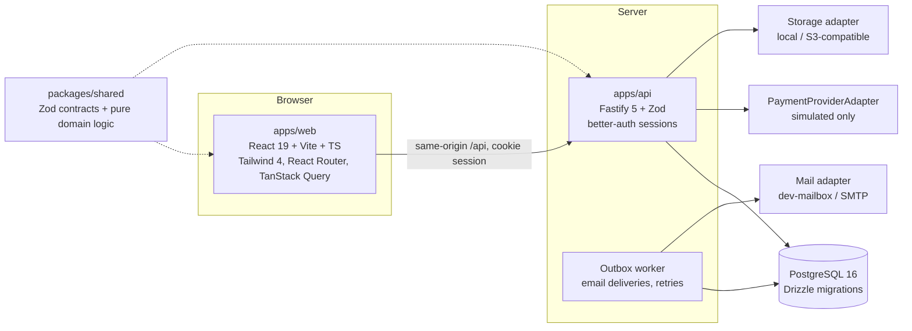

# Implementation Plan — 5 Diamonds Tournament Baseball

Source of truth: `5_diamonds_website_development_spec_v1.md` (v1.0, 2026-10-15).
This file is the working roadmap. Status markers are updated as work lands; see
`DECISIONS.md` for rationale and the open owner-decision list.

Legend: ✅ done & tested · 🟡 partial (see notes) · ⬜ not started · ⛔ blocked on owner

## 1. Starting point

- Repository was empty (greenfield). No existing code, assets, or exports were provided.
- Legacy site (`5diamondstournamentbaseball.com`) is a hosted BaseballShift/DigitalShift
  site. It was crawled for **content inventory only** (see `CONTENT_INVENTORY.md`).
- No official logo, brand colors, rules, venues, fees, or event records were supplied, so
  every such value in this repo is a **temporary token or `DEMO` fixture**.

## 2. Architecture (summary — details in `ARCHITECTURE.md`)

- `packages/shared` holds API contracts (Zod) and **pure domain logic**: capacity rules,
  schedule conflict detection, bracket construction/advancement, standings, roster
  validation, CSV parsing. These are unit-tested without a database.
- `apps/api` owns every business rule and authorization decision. The web bundle never
  contains secrets or privileged logic; hiding a button is never the only control.

## 3. Vertical slices

Each slice must ship with migrations, server authorization, loading/empty/error states,
and automated tests before it's marked ✅.

### Slice 1 — First runnable flow (spec §20.2)
Director creates & publishes event → manager registers team → admin views registration →
published schedule is publicly visible.
- Monorepo, Docker Postgres, migrations, seed (`DEMO` fixtures), env config
- Auth: sign-up, email verification (dev mailbox), login/logout, password reset
- Roles & policy guards (deny-by-default, tournament-scoped)
- Admin: tournaments, divisions, venues/fields, publish lifecycle
- Public: tournament finder + detail
- Manager: multi-team CRUD, registration with transactional capacity + waitlist
- Admin: registrations list, status changes with reason + audit
- Native schedule editor: create/edit games, validate, save draft, preview, publish
- Public schedule: game cards by date/team/field, Eastern time display

### Slice 2 — Rosters
- Manual roster editing, bulk paste, CSV/XLSX import with preview + row errors
- Roster lock at event deadline; immutable per-registration snapshots
- Formula-injection-safe CSV export & template

### Slice 3 — Brackets, scores, standings
- Single-elimination builder (sizes 2–64, byes, seeding), structural graph storage
- Score entry & finalize (assigned scorekeepers / directors), optimistic concurrency
- Winner advancement only on `final`; downstream-conflict detection on correction
- Pool standings derived from finals; tie-breakers unofficial until configured
- Public bracket: desktop tree + mobile round-by-round list

### Slice 4 — Game day & notices
- Scoped announcements (org/event/division/venue/field/game), severity, expiry,
  all-clear/superseded, affected games, history
- `/game-day` hub, alert banners, "Updated [time]" + polling
- Email outbox with retry/backoff, failure logging, preferences

### Slice 5 — Content & SEO
- CMS pages (draft/preview/publish + revisions), news, staff, partners/sponsors, media
  metadata, FAQs, venues pages
- Contact form (rate limit, honeypot, private storage)
- SEO metadata, sitemap, robots, canonical URLs, legacy 301 map, noindex private areas

### Slice 6 — Hardening & handoff
- Playwright phone/desktop flows for spec §16 acceptance tests, axe a11y checks
- Concurrency/IDOR integration tests, load-test harness (k6) — results must be measured
- Security headers/CSP, MFA for staff, backups/restore runbook, Docker deploy docs

## 3a. Status as of 2026-10-15 (end of first build session)

**Verified:** 49 domain unit tests · 44 API integration tests (real Postgres) · 13 Playwright E2E flows
(desktop + Pixel 7, with axe WCAG 2.2 AA scans and no-horizontal-scroll checks) · typecheck · production
builds · Docker images smoke-tested together (proxy, SPA fallback, 301s, security headers, production config guard).

| Slice | Status | Notes |
|---|---|---|
| 1 Foundation + first flow | ✅ | Monorepo, migrations, DEMO seed, auth (verify/reset/2FA), roles/policies, tournaments/divisions/venues, registration w/ capacity locking + waitlist, admin registrations, native schedule → public |
| 2 Rosters | ✅ | Manual, bulk paste, CSV/XLSX preview with row errors, atomic save, lock + immutable snapshots, staff revisions, safe CSV export, template |
| 3 Brackets/scores/standings | ✅ | Single elimination 2–64 with byes, graph integrity, advancement on final only, `DOWNSTREAM_CONFLICT` resolution, configurable tie-breakers (unofficial until signed off), desktop tree + mobile list |
| 4 Game day & notices | ✅ | Scoped notices, severity, expiry, all-clear, affected games, history, author; `/game-day`; 30 s polling; email outbox w/ retry + DLQ, opt-in |
| 5 Content & SEO | 🟡 | Pages (draft/preview/publish/revisions, legal approval gate), news, partners, staff directory, FAQs, contact (honeypot + rate limit), sitemap, robots, canonical, 301 map. **Media uploads not built** (table only; `/media` is a CMS text page) |
| 6 Hardening | 🟡 | Automated a11y, IDOR, concurrency and permission tests done. **Not done:** load test run (script ready), manual keyboard + screen-reader review, backup/restore drill, monitoring, real SMTP deliverability, legal review |

### Known gaps / not implemented (do not treat as complete)

- **Media library uploads** (object-storage adapter, validation, alt text/rights UI). `STORAGE_DRIVER` is config only.
- **Field availability windows / blackouts:** the validator supports them, but there's no data model or UI to enter them yet.
- **Schedule editor:** click-to-add board + keyboard dialog and duplicate. **No drag-and-drop and no undo** (revisions are recorded in `game_versions`, with no restore UI).
- **Suggested pool-play generator** (stretch) and schedule CSV import/export: not built.
- **Additional coaches / team ownership transfer:** schema only (`team_memberships`), no workflow.
- **Waitlist promotion** is manual (director confirms, with capacity override if full). No automatic offers.
- **Bracket formats** other than single elimination are not supported and are labeled as such.
- **Payments:** simulated provider only. Real provider integration is deferred by decision C11.
- **Staff MFA** is enforceable (`STAFF_MFA_REQUIRED=true`) but off in dev. Must be on for launch.
- **API rate limits** (non-auth) are per-instance in memory (ADR-019).
- **SMS/push:** deferred by decision.

## 4. Testing strategy

| Layer | Tool | Scope |
|---|---|---|
| Domain unit | Vitest | shared: capacity, conflicts, brackets, standings, roster/CSV |
| API integration | Vitest + real Postgres (`fivediamonds_test`) | transactions, ownership, staff scoping, IDOR, concurrency, file validation |
| E2E | Playwright (desktop + Pixel/iPhone profiles) | spec §16 flows |
| A11y | @axe-core/playwright + manual keyboard/SR review checklist | |
| Load | k6 script (not run against prod) | burst before games / rain delays |

## 5. Launch blockers (owner input required)

See `DECISIONS.md §Pending owner decisions`. Highest risk to real-event operation:
bracket formats beyond single elimination, tie-breaker hierarchy, age eligibility,
registration review/waitlist/payment policy, official brand assets, venue data, legal copy.
